# C.O.R.E.
### Cognitive Operation and Reasoning Engine

> *C.O.R.E. is maintained as a private sovereign system because it runs on personal hardware and concerns real-world credentials, private notes, and personal data. This repository is a public architectural representation of C.O.R.E.; it is not the private implementation and does not expose operational code, credentials, personal memory databases, or private network configuration.*

> **Project boundary:** Project 6 is the private implementation and field-testing environment. Project 6.1, C.O.R.E. Showcase, documents the public system concept, architecture, design decisions, interface representation, and future roadmap because the complete C.O.R.E. system is not prototype-ready.

---

## What is C.O.R.E.?

C.O.R.E. is a **sovereign cross-device operating ecosystem** that originated as a digital companion and has evolved into an orchestration layer for multi-agent workflows, personal memory, and hardware tasks.

Two client concepts. One encrypted device-to-device mesh design. No third-party relay is intended for the device bridge; external model APIs remain an explicit Phase 1 dependency.

- **JAMES** — Mobile client (Flutter · Android). Mobile-first interactions, voice interface, and local offline GGUF inference.
- **DAVID** — Desktop workstation client (React + Python · Windows). Heavy compute, multi-agent swarms, and system orchestration.
- **Bridge** — Proposed encrypted Tailscale mesh with store-and-forward offline queuing.
- **Memory Engine** — Proposed two-tier architecture: local behavioral memory ($S(t) = S_0 \cdot e^{-\lambda t}$) and shared multimodal RAG (`A.X.I.O.M.`). The Memory Intelligence Engine is documented separately as an Applied Data Science project.
- **Execution Depth Engine** — Designed dual-gear processing: `STANDARD` and `MAX_DEPTH` Swarm Overdrive. The latency figures are design budgets, not public production benchmarks.

---

## 🏛️ The Umbrella Ecosystem

C.O.R.E. serves as the central orchestrator that connects and powers my specialized intelligence subsystems:

```
┌────────────────────────────────────────────────────────────────────────────────────────┐
│                              THE PERSONAL AI ECOSYSTEM                                 │
├────────────────────────────────────────────────────────────────────────────────────────┤
│                                                                                        │
│                      ┌──────────────────────────────────────────────────────────────┐  │
│                      │ [ CORE ENGINE PILLARS ]                                      │  │
│                      │ ┌──────────────────────────┐  ┌───────────────────────────┐  │  │
│                      │ │   C.O.R.E. Memory Engine │  │         A.X.I.O.M.        │  │  │
│                      │ │  BEHAVIORAL DECAY & SYNC │  │  OMNIMODAL RAG LIBRARY    │  │  │
│                      │ └──────────────────────────┘  └───────────────────────────┘  │  │
│        ( 00 )        │                                                              │  │
│       C.O.R.E.       ├──────────────────────────────────────────────────────────────┤  │
│  CENTRAL ORCHESTRATOR│ [ APPLIED CAPABILITIES ]                                     │  │
│                      │ ┌──────────────────────────┐  ┌───────────────────────────┐  │  │
│                      │ │       TLDR Shield        │  │       LaunchMintAI        │  │  │
│                      │ │ PRIVACY & INGESTION RISK │  │ FORENSIC MARKET CORTEX    │  │  │
│                      │ └──────────────────────────┘  └───────────────────────────┘  │  │
│                      │ ┌─────────────────────────────────────────────────────────┐  │  │
│                      │ │                    Future Expansion                     │  │  │
│                      │ │                 INFINITE NODE CAPACITY                  │  │  │
│                      │ └─────────────────────────────────────────────────────────┘  │  │
│                      └──────────────────────────────────────────────────────────────┘  │
└────────────────────────────────────────────────────────────────────────────────────────┘
```

1. **[TLDR Shield](https://github.com/Jatin23K/TLDR-Shield)** — The *Privacy Ingestion Shield*. Scans policy documents and privacy risks across 6 pillars with verbatim DOM highlighting.
2. **[LaunchMintAI](https://github.com/Jatin23K/LaunchMintAI)** — The *Market Research Cortex*. Evaluates startup ideas and competitors using XGBoost models ($AUC = 0.8170$) and Monte Carlo simulations.
3. **C.O.R.E. Memory Intelligence** — A separate Applied Data Science project that explores lifecycle classification and storage-cost optimization for a future C.O.R.E. memory subsystem. Its empirical metrics do not represent the completeness of the C.O.R.E. ecosystem.
4. **[A.X.I.O.M.](https://github.com/Jatin23K/A.X.I.O.M)** — The *Enterprise Omnimodal RAG Architecture Specification*. Its multimodal retrieval and cache figures are designed targets, not measured C.O.R.E. production results.

---

## System Phases & Status

**Phase 1 — Field Testing · Incomplete / Hardware Constrained**
The C.O.R.E. concept and selected client flows are under field testing. Phase 1 is not complete: mobile inference, background execution, battery, thermal behavior, and network reliability impose active hardware and platform limits. This public repository documents the representation and design of the system; it is not proof that the complete ecosystem is prototype-ready.

| Component | Status | Implementation Details |
|---|---|---|
| JAMES (Mobile Client) | ⚠️ Field testing | Flutter · Android · Persona concept · Local GGUF fallback; constrained by mobile hardware and Android lifecycle behavior |
| DAVID (Desktop Client) | ⚠️ Field testing | React + Python · Windows · Desktop compute and orchestration concept |
| Encrypted Mesh Bridge | ⚠️ Under test | Tailscale/WireGuard peer-to-peer design; reconnect and queue behavior remain field-testing concerns |
| Execution Depth Engine | ◇ Designed / evaluated | Dual-gear `STANDARD` and `MAX_DEPTH` behavior; latency values are target budgets |
| Model Adapter & Normalizer | ◇ Design specification | `ModelAdapter` + `SchemaNormalizer`; regression criteria are defined for future implementation validation |
| Ephemeral Vault Security | ◇ Security design | RAM-only key and heartbeat-zeroization model; requires implementation and adversarial validation |

**Phase 2 — Sovereign Ecosystem · Specification Designed**
Scaling toward a dedicated Always-On Central Node (Standalone Hardware Host) managing the master Qdrant index, Risk-Gated cross-device command dispatcher, Home Assistant / MQTT IoT protocol bus, and auxiliary remote compute nodes.

---

## Screenshots & Interface Representation

The screenshots represent interface concepts and selected field-testing evidence. They do not prove that every documented backend capability, security property, or Phase 2 component is complete.

### JAMES vs JANIE — Mobile Client
One Flutter client. Two distinct cognitive profiles. UI color shifts reflect deep backend prompt, reasoning, and context reloads.

| JAMES (Analytical & Direct) | JANIE (Warm & Conversational) |
|---|---|
| 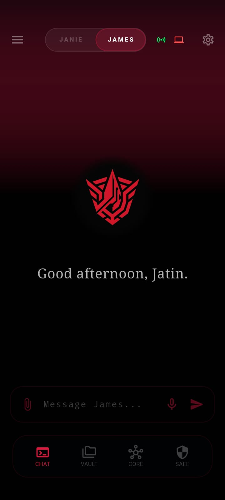 | 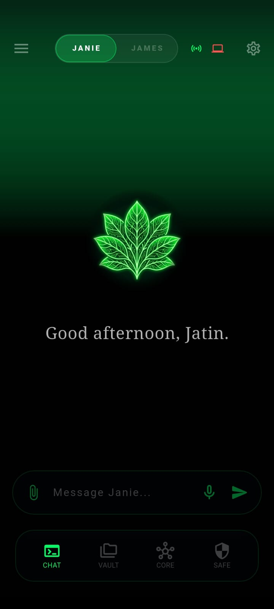 |
| 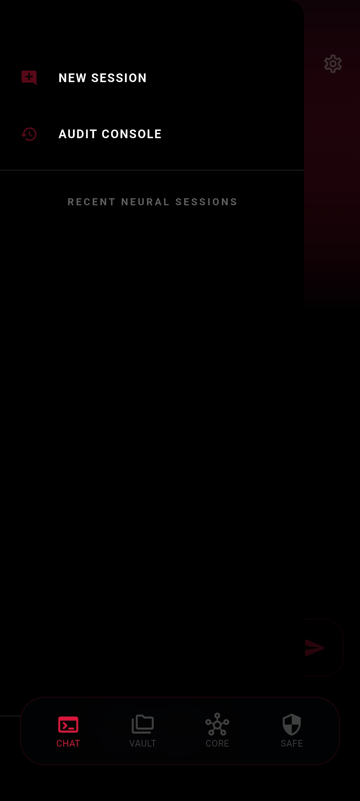 | 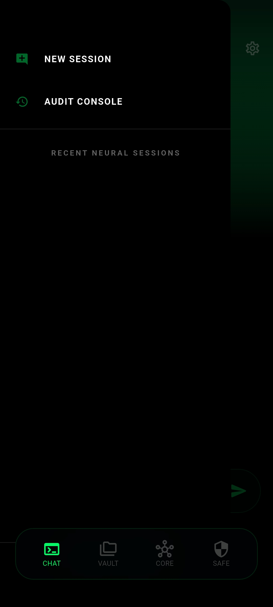 |
| 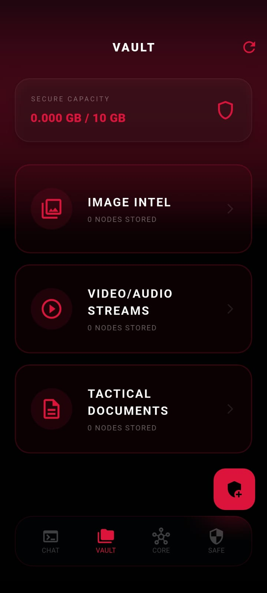 | 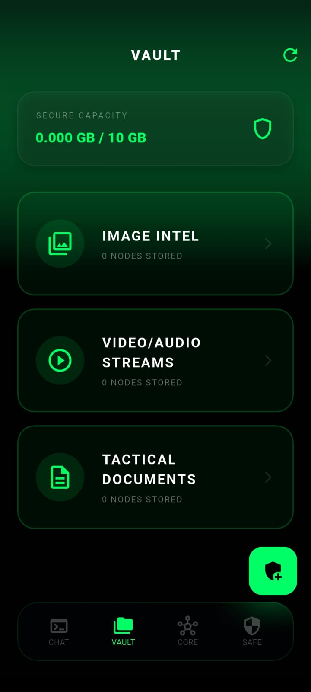 |

### DAVID vs DARA — Desktop Client
One React shell. One Python backend. Red → Green visual confirmation accompanies a full reasoning matrix context reload.

| DAVID (Analytical & Research) | DARA (Reflective Mentor) |
|---|---|
| 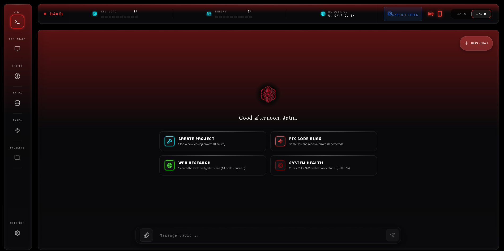 | 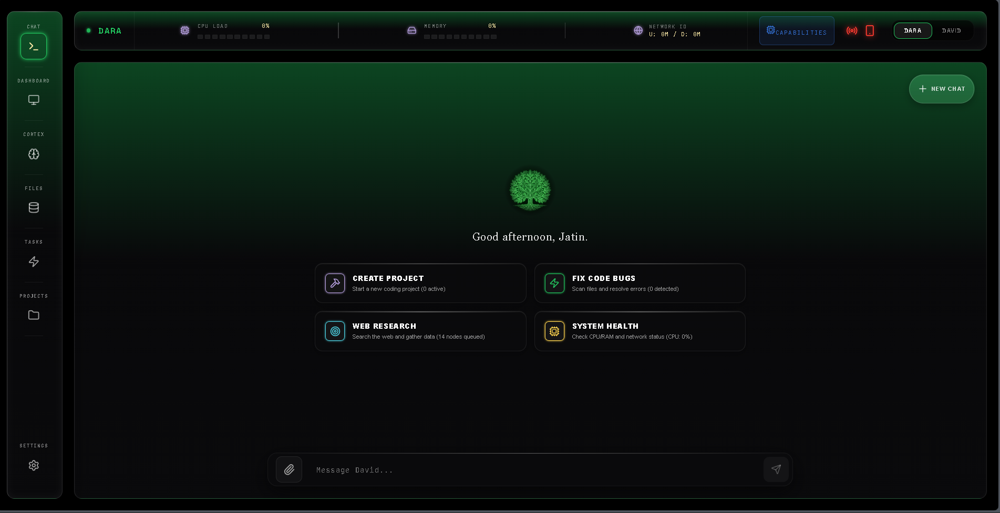 |
| 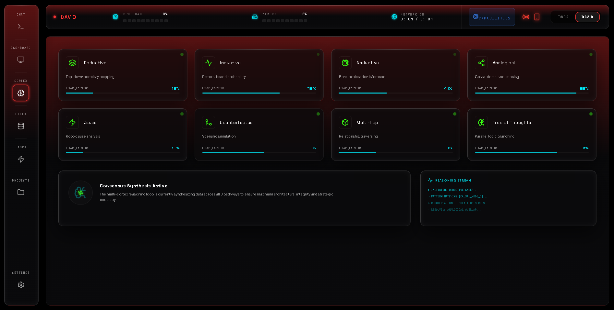 | 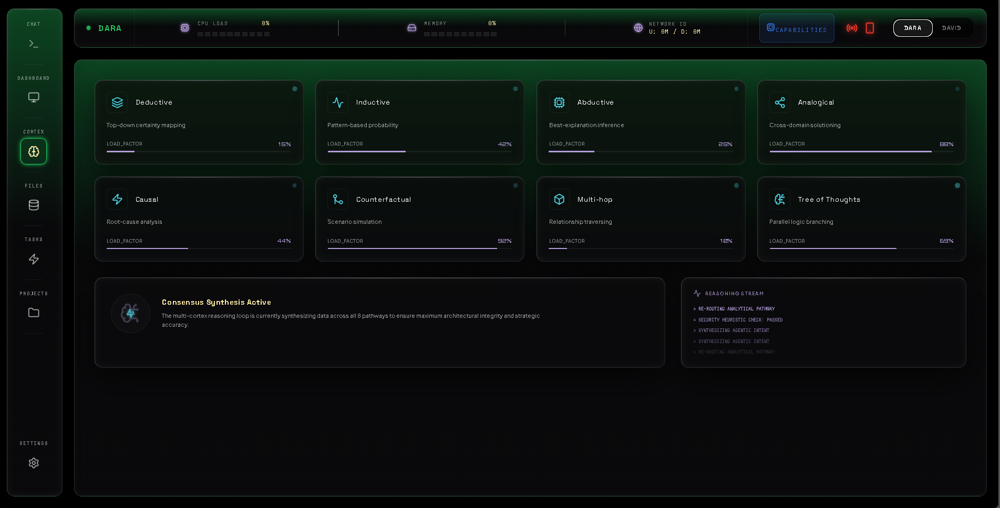 |
| 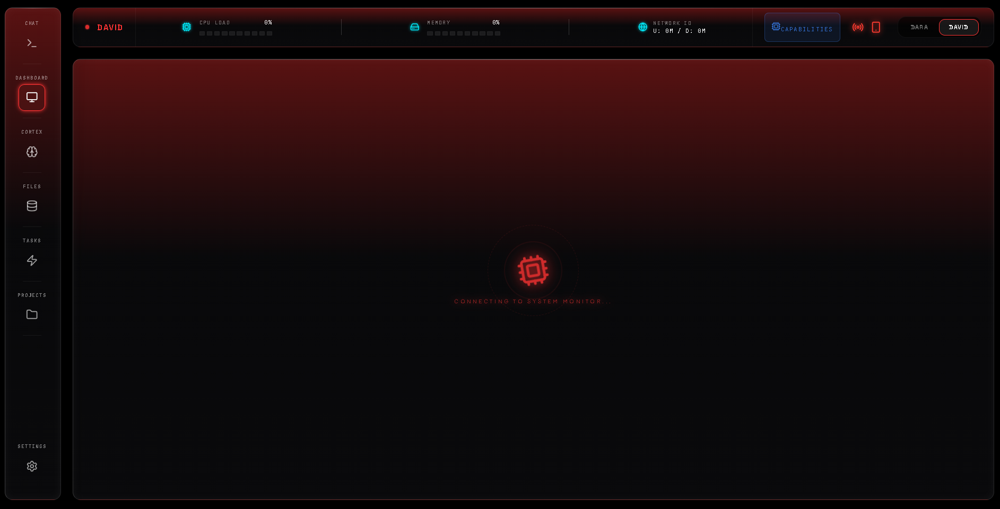 | 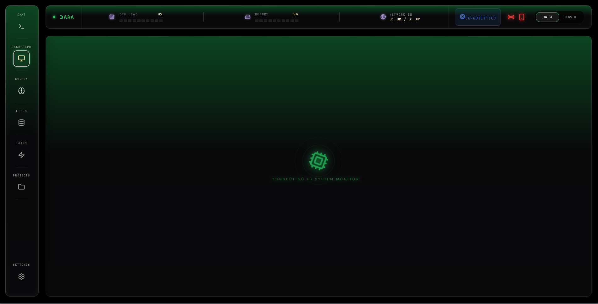 |
| 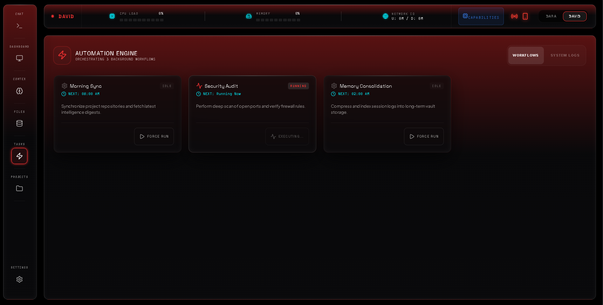 | 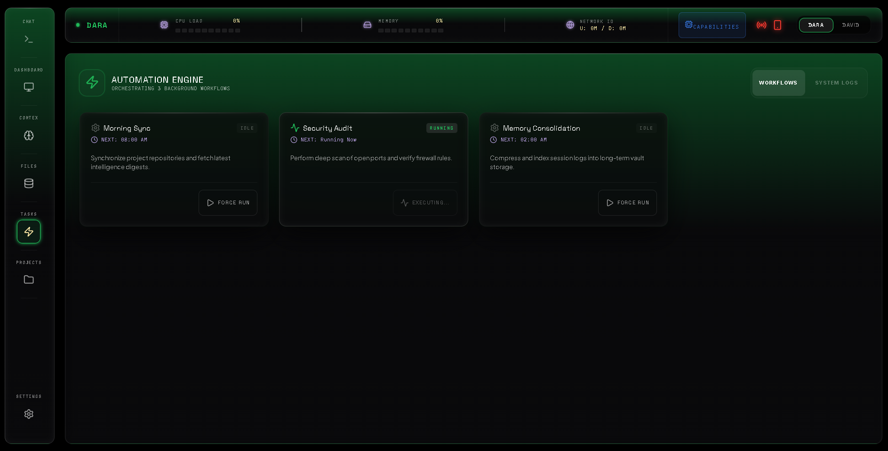 |

---

## Technical Architecture & Engineering Documents

| Document | What it covers |
|---|---|
| [ARCHITECTURE.md](./docs/ARCHITECTURE.md) | Topology, Execution Depth Engine, ModelAdapter abstraction, and trade-offs |
| [MEMORY_PIPELINE.md](./docs/MEMORY_PIPELINE.md) | Proposed separation of local behavioral memory and shared factual knowledge |
| [EPHEMERAL_VAULT_SECURITY.md](./docs/EPHEMERAL_VAULT_SECURITY.md) | Proposed Tailscale heartbeat, RAM-only key, and offline isolation model |
| [PERSONA_ENGINE.md](./docs/PERSONA_ENGINE.md) | Dual-persona backend engine — JAMES/JANIE and DAVID/DARA prompt matrices |
| [INFORMATION_SOVEREIGNTY.md](./docs/INFORMATION_SOVEREIGNTY.md) | Autonomous monitoring, noise filtering, and personalized synthesis digests |

---

## Tech Stack

* **Mobile Client (JAMES):** Flutter · Dart · Android · Local Termux GGUF Inference
* **Desktop Client (DAVID):** React 18 · TypeScript · Python · FastAPI · DirectML GPU Acceleration
* **Bridge & Network:** Tailscale VPN · WireGuard Mesh Protocol · WebSocket Telemetry
* **Memory & Storage:** SQLite (Local Node Storage) · Qdrant Vector DB (Phase 2 shared-knowledge target) · Redis (Phase 2 async-queue target)
* **Model Layer:** Provider-Agnostic Abstraction (`ModelAdapter`) · Google Gemini API · Local Ollama / GGUF
* **Security Layer:** Ephemeral RAM Decryption Keys · Tailscale Heartbeat Verification · Zero-Knowledge Metadata Routing

---

## Status & Sovereignty

```
Phase 1: Field Testing (Incomplete; Hardware Constraints Active)
Network: Tailscale Encrypted Mesh
Execution Depth: Dual-Gear (STANDARD / MAX_DEPTH)
Public repository role: Architecture representation and design record; private implementation is not included
```

---

*Built by Jatin Kumar — A sovereign personal operating ecosystem.*
