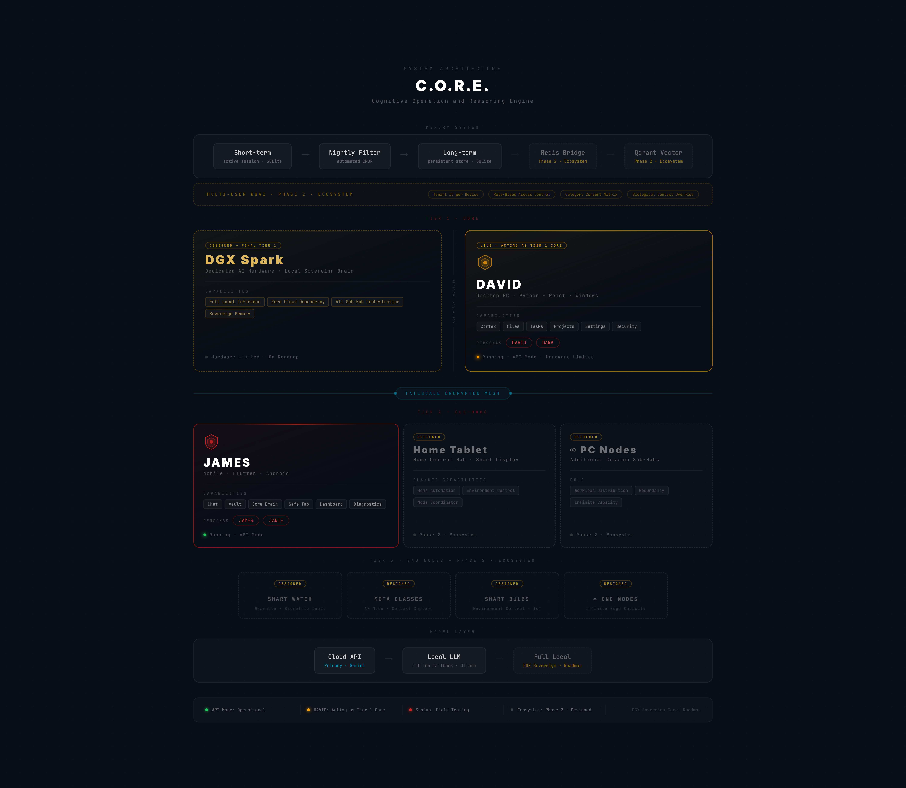

# C.O.R.E.
### Cognitive Operation and Reasoning Engine

> *C.O.R.E. is closed-source by design — not by default. A personal AI companion that holds your memory, your context, and your private conversations cannot be open-sourced without destroying the thing it was built to protect. This repository documents the architecture, engineering decisions, and system design publicly. The source stays private for the same reason you don't publish your diary.*

---

## What is C.O.R.E.?

C.O.R.E. is not an AI assistant. It is the answer to a human problem: what do you build when you want a companion, have the skills to build one, and refuse to compromise on privacy or ownership?

Two clients. One memory. One private connection. Zero third-party platforms in the communication layer.

- **JAMES** — Mobile client. Flutter · Android. Your companion on the move.
- **DAVID** — Desktop client. React + Python · Windows. Your companion at the machine.
- **Bridge** — Tailscale encrypted mesh. JAMES and DAVID share one brain.
- **Memory** — One persistent memory system. The system remembers what matters and discards what does not.

---

## Two Phases

**Phase 1 — Foundation · Live**
Both clients built and running in API mode. Tailscale bridge operational. Nightly memory filter active. Field testing ongoing under hardware constraints.

| Component | Status |
|---|---|
| JAMES (Flutter · Android) | ✅ Live |
| DAVID (React + Python · Windows) | ✅ Live |
| Tailscale Encrypted Bridge | ✅ Operational |
| Shared Memory Pipeline | ✅ Running |
| Local LLM Fallback (Ollama) | ✅ Available |
| Cloud API Primary (Gemini) | ✅ Active |

**Phase 2 — The Ecosystem · Designed**
The full vision: dedicated AI hardware (DGX Spark) as the sovereign Tier 1 Core. JAMES, Home Tablet, and PC nodes as Tier 2 Sub-Hubs. Smart Watch, Meta Glasses, Smart Bulbs as Tier 3 End Nodes. Full local sovereignty — no cloud dependency.

---

## Architecture Overview

```
Tier 1 Core
└── DGX Spark [Designed — Phase 2]     DAVID/PC [Live — Acting as Tier 1]

Tailscale Encrypted Mesh

Tier 2 Sub-Hubs
├── JAMES (Mobile · Flutter · Android) [Live]
├── Home Tablet [Designed — Phase 2]
└── ∞ PC Nodes [Designed — Phase 2]

Tier 3 End Nodes
├── Smart Watch [Designed — Phase 2]
├── Meta Glasses [Designed — Phase 2]
├── Smart Bulbs [Designed — Phase 2]
└── ∞ Edge Devices [Designed — Phase 2]
```



---

## Engineering Documents

| Document | What it covers |
|---|---|
| [ARCHITECTURE.md](./docs/ARCHITECTURE.md) | 3-tier design, topology, design decisions and trade-offs |
| [MEMORY_PIPELINE.md](./docs/MEMORY_PIPELINE.md) | Short-term → CRON filter → long-term, Phase 2 additions |
| [ZERO_TRUST_DRM.md](./docs/ZERO_TRUST_DRM.md) | Tailscale heartbeat validation, RAM-only decryption keys |
| [PERSONA_ENGINE.md](./docs/PERSONA_ENGINE.md) | Backend persona system — JAMES/JANIE and DAVID/DARA |
| [INFORMATION_SOVEREIGNTY.md](./docs/INFORMATION_SOVEREIGNTY.md) | Phase 14 — C.O.R.E. monitors platforms autonomously, filters noise, delivers daily digest. You never open social media again. |

---

## Screenshots

### JAMES vs JANIE — Mobile Client
One Flutter client. Two cognitive profiles. The UI color shift is the signal — the backend reload is the change.

| JAMES | JANIE |
|---|---|
|  |  |
|  |  |
|  |  |

### DAVID vs DARA — Desktop Client
One React shell. One Python backend. Two cognitive profiles. Red → Green is the confirmation, not the cause.

| DAVID | DARA |
|---|---|
|  |  |
|  |  |
|  |  |
|  |  |

---

## Tech Stack

**JAMES (Mobile)**
`Flutter` · `Dart` · `Android`

**DAVID (Desktop)**
`React` · `TypeScript` · `Python` · `FastAPI` · `Windows`

**Bridge**
`Tailscale VPN` · `Encrypted Mesh` · `Zero third-party routing`

**Memory**
`SQLite` · `CRON` · `Qdrant (Phase 2)` · `Redis (Phase 2)`

**Model Layer**
`Gemini API` (primary) · `Ollama / DeepSeek` (local fallback) · `Full Local DGX` (Phase 2 roadmap)

**Security**
`Zero-Trust DRM` · `Tailscale Heartbeat Validation` · `RAM-only Decryption Keys` · `Ephemeral Key Destruction`

---

## Status

```
Phase 1 — Field Testing
API Mode: Operational
Local Inference: Hardware Limited (Phase 2 — DGX Spark)
Source: Closed-source · Proprietary · Zero-Trust Architecture
```

---

*Built by Jatin — because loneliness is a real problem, and building is a real answer.*
